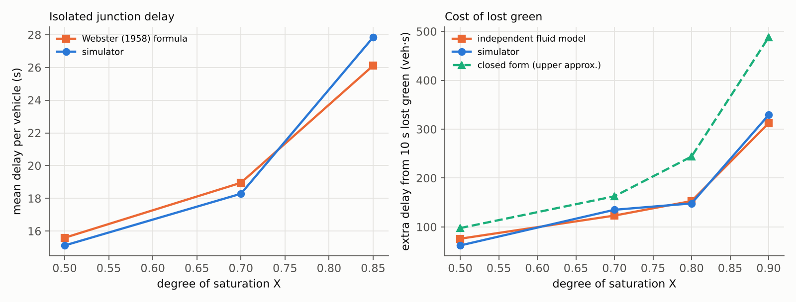
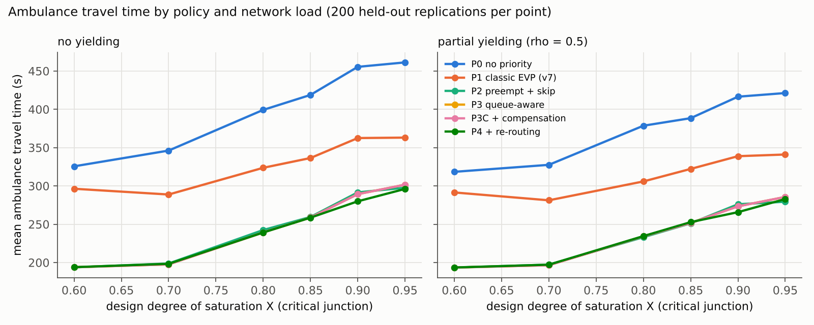
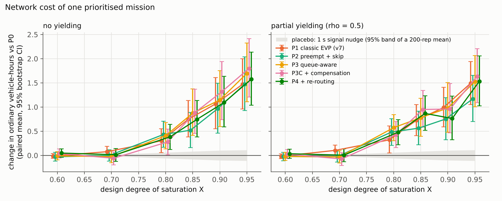
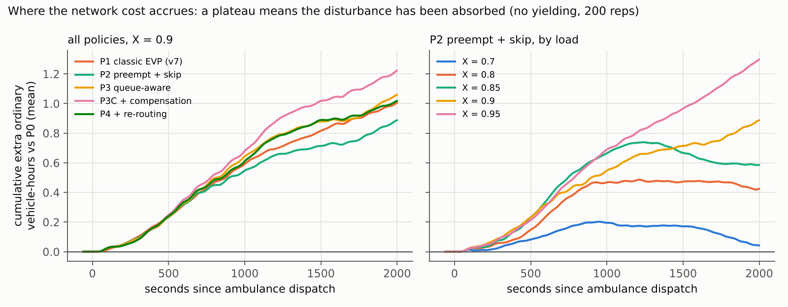
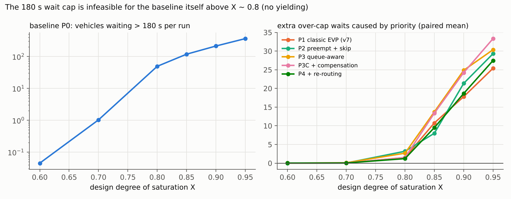
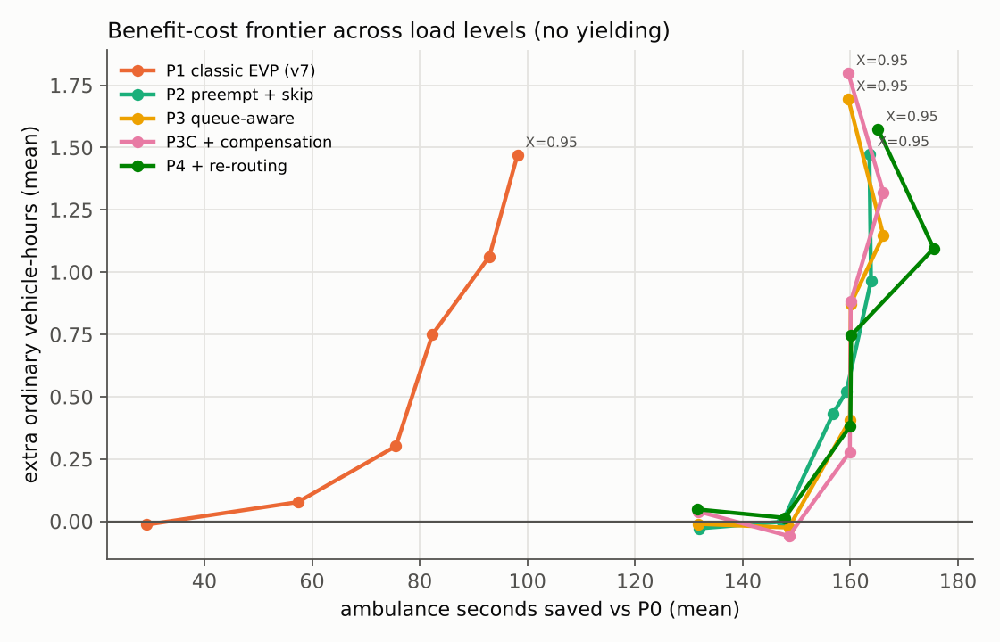
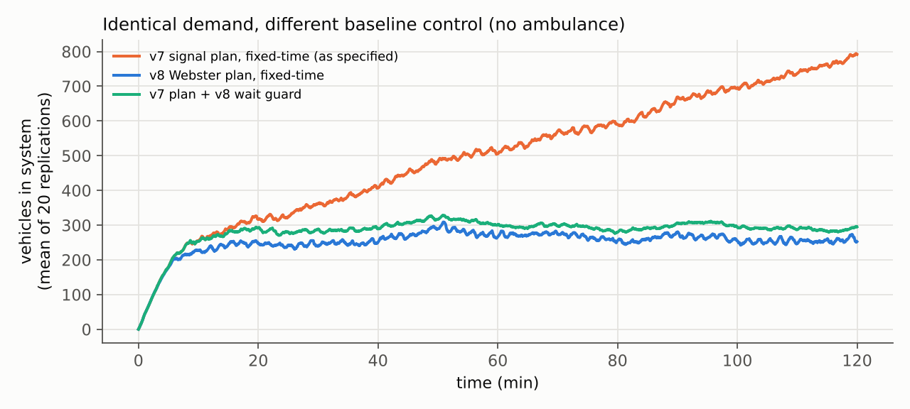

# Abstract

We ask two linked questions. How much can signal priority shorten an ambulance's trip through a congested signalised district? What does that priority cost ordinary traffic, and how does the cost depend on network load? We built a 1-second mesoscopic spatial-queue simulator of a 16-junction synthetic district with spillback, mixed vehicle classes in passenger-car units (PCU), Webster-optimised fixed-time signals, noisy sensors and a stochastic demand process. We verified it against Webster's (1958) delay formula (errors of −3.5% to +6.6%) and against an independent fluid queueing model. We then compared one no-priority baseline with five priority policies in a paired, common-random-number experiment: 14,400 held-out simulations across six load levels (critical degree of saturation X = 0.60–0.95) and two driver-yielding regimes. Policy parameters were tuned on separate training replications.

Four findings stand out:

- **Phase skipping is the lever that matters.** Preemption with phase skipping cuts mean ambulance travel time by 125–164 s (35–43%). Classic extension/truncation priority, the v7 design, achieves only 27–98 s, and skipping costs no more network delay than it does.
- **The cost to ordinary traffic follows a 1/(1−X) law.** It is statistically zero for X ≤ 0.7. It rises to about 1 vehicle-hour per mission at X = 0.9 and 1.5 at X = 0.95. The exchange rate climbs from about 10 to 32 vehicle-seconds of ordinary delay per ambulance-second saved. Above X ≈ 0.9 the disturbance is not absorbed within 33 minutes.
- **The refinements we expected to help did not.** Queue-aware triggering and post-priority compensation produced no measurable improvement. Queue-aware re-routing helped only near saturation (−9 s at X = 0.9). Even perfect state information is worth at most about 6 s, so the expensive particle-filter estimator planned in v7 is not justified.
- **The protections can't always hold.** The 180 s wait caps are infeasible for the baseline itself above X ≈ 0.8, so protections must be framed as soft targets or load-dependent.

We also show that a 1-second signal nudge at a single junction moves network delay by as much as the ambulance does. Network-level effects of a single intervention are therefore only detectable with paired designs of order 10² replications.

# 1. Research question and why it is hard

Emergency-vehicle preemption (EVP) gives an ambulance green lights along its route. The benefit to the ambulance is easy to see. The cost is diffuse: conflicting approaches lose green, queues grow, and the backlog spreads through the network after the ambulance has gone. Three things make this cost hard to measure:

1. **It depends on load, nonlinearly.** The delay from losing Δ seconds of green on an approach with saturation flow *s* scales roughly as (sΔ)²/(c(1−X)). The same intervention is free at X = 0.6 and expensive at X = 0.95 (§6.2, and test T5 in §4).
2. **It is small relative to the noise.** Traffic networks are sensitive to small perturbations: re-ordering a few vehicles changes every later interaction. Comparing a single priority run with a single no-priority run therefore measures mostly noise (§6.7).
3. **The baseline matters.** A badly timed baseline creates its own congestion, and the measured cost of priority then mostly reflects that congestion rather than the priority (§2).

# 2. From v7 to v8: what was wrong and what changed

v7 was an input fixture with no simulator, optimiser or results. A referee review identified the problems below. Every item is addressed in v8 and backed by evidence in this report.

| # | v7 issue | v8 change | Evidence |
|---|---|---|---|
| 1 | Random greens (20/24/28 s) made 8/51 approaches oversaturated at mean demand | Demand calibrated to a declared target X; Webster cycle and demand-proportional splits per junction | Fig. 5: at identical demand the v7 plan accumulates about 275 veh/h and strands 283 vehicles at the boundaries after 2 h; Webster is stationary |
| 2 | Results were an unacknowledged function of load | Load X is the primary experimental axis (6 levels) | Figs. 1–4 |
| 3 | 2 s "near-fastest" tolerance far below Monte Carlo noise (SE ≈ 9 s) | Paired common random numbers, 200 replications per cell, bootstrap CIs, sign-flip tests, Holm correction | `tables/main_results.csv` |
| 4 | 32 scenarios cannot certify a 5% failure rate | 200 replications; exact Clopper–Pearson intervals | `tables/tail_risk.csv` |
| 5 | Optimiser's curse (best of 528 on the same 32 scenarios) | Tuning on training replications 5000–5039; evaluation on held-out replications 0–199 | `tuned_parameters.json` |
| 6 | Action set capped benefit (no phase skip; ≥ 56–69 s forced wait per junction) | Preemption with phase skip (P2), protected by a pedestrian/vehicle wait guard | P2 − P1 = −65 to −103 s (§6.1) |
| 7 | Queue ahead of the ambulance can exceed one green | Queue-aware trigger (P3) tested explicitly | No measurable gain (§6.5): a negative result |
| 8 | No driver yielding | Class-weighted yielding model, ρ ∈ {0, 0.5} | §6.8 |
| 9 | Compute target infeasible (≈ 10¹⁰–10¹¹ ops/s) | Rule-based controllers; value-of-information bound | 13 µs median decision (§6.10); perfect information worth ≤ 6 s (§6.6) |
| 10 | `routes.csv` leaked hidden initial state (r = 0.85) | Strict `public/` vs `hidden/` export | Test T6: public files byte-identical across replications |
| 11 | One RNG stream (no common random numbers across design variants) | SHA-256 namespaced streams | Test T1b |
| 12 | All-or-nothing routing left 12/51 approaches empty | Up to 4 near-shortest routes per OD pair with a logit split | 0 empty approaches |
| 13 | 600 s warm-up | MSER-5 warm-up = 1,405 s (X = 0.8) and 1,625 s (X = 0.95); dispatch after 1,800 s | §5 |
| 14 | Static packed initial snapshot | Initial state reached by simulated warm-up; exported as `hidden/state_at_dispatch.csv` | Fixture |
| 15 | 788 of 803 checks were tautological | Runtime invariants plus external validation | §4 |
| 16 | Buses counted like motorcycles | PCU-based storage and discharge | `network.py` |
| 17 | AR(1) demand shock not stationary at the start | Stationary initialisation | `scenario.py` |
| 18 | "Correlated" outages drawn independently | Spatially clustered common-cause outage | `sim.py` |
| 19 | Protection definitions ambiguous | Per-vehicle stop-line wait ≤ 180 s and pedestrian wait ≤ 180 s, enforced by an earliest-deadline guard shared by **all** policies | §6.4 |

Two corrections to the v7 review are also on record:

- **The review's cost estimate was too high.** Its closed-form lost-green cost overstates the exact fluid-model cost by 1.3–1.6×, although the 1/(1−X) scaling holds (Fig. 6, right).
- **The v7 demand level was not the problem.** Under Webster timing it gives X ≈ 0.79. The oversaturation came from the signal plan.

# 3. Model

**Network.** The v7 geometry is kept unchanged: 16 signalised junctions, 8 boundary nodes, 59 directed links of 260–472 m, with one- and two-lane links. Saturation flows are 0.40–0.48 PCU/s/lane and jam density is 0.16 PCU/m/lane. Free-flow speeds are 30 and 40 km/h.

**Demand.** Each origin releases vehicles as a Poisson process whose rate is modulated by a common AR(1) log-normal shock (ρ = 0.75 per minute, σ = 0.18, stationary). Destinations follow a gravity model with hospital attraction. Each OD pair has up to 4 routes within 1.25× of the free-flow time, split by a logit model (θ = 0.05 s⁻¹). The class mix is 53% cars, 30% motorcycles, 10% autorickshaws, 4% buses and 3% goods vehicles, with PCU values 1.0 / 0.5 / 1.0 / 3.0 / 2.5. A single scale factor κ is solved by bisection so that the critical approach reaches the target X under its Webster plan.

**Signals.** Each green serves one protected approach (3 s amber, 2 s all-red), followed by an exclusive pedestrian stage (7 s walk, 16 s clearance, 2 s all-red). Webster cycles are clipped to 60–150 s, with greens of 8–60 s. The **base controller**, used by every policy including the baseline, adds an earliest-deadline-first guard. At each stage choice it projects the coming stage sequence. If any waiting vehicle (detected by a stop-line presence detector) or the pedestrian stage would exceed 180 s, it serves the most urgent stage first.

**Simulator.** Each link is a FIFO queue with finite PCU storage, so spillback and gridlock emerge from the dynamics. Vehicles reach the stop line after the free-flow time and discharge at the saturation flow during green (after a 2 s start-up loss) and amber. Multi-lane approaches expose one head per lane. Boundary demand waits in external queues, and that waiting counts as delay. Incidents (probability 0.5 per replication) reduce one lane of a two-lane link to 45–65% capacity for 4–8 minutes near the dispatch time. Sensors are 5 s link-count cameras with {−2…+2} noise, Markov dropout and a clustered outage.

**Ambulance.** The ambulance obeys the signal, has no speed privilege, and uses no opposing lanes. It is dispatched to the hospital (BE1) from one of six boundary origins at a random time 1,800–2,100 s into the run. With yielding parameter ρ, each queued vehicle ahead of it pulls aside with probability ρ·w, where w is 1.0 for motorcycles, 0.8 for autorickshaws, 0.6 for cars and 0.2 for buses and goods vehicles.

**Policies.**

| Policy | Logic |
|---|---|
| P0 | No priority (base controller only) |
| P1 | Classic EVP, the v7 design: queue-blind trigger when the ambulance's free-flow ETA ≤ H; extends the ambulance green by up to 10 s; truncates conflicting greens to the 8 s minimum; no skipping |
| P2 | Preemption: P1 plus a jump to the ambulance approach after the current clearance (skipping the walk stage only if its wait clock allows); holds the green until the ambulance crosses (cap 60 s) |
| P3 | Queue-aware preemption: as P2, but the trigger subtracts the estimated time to discharge the queue ahead of the ambulance and adds upstream queue delays, plus a margin; hold cap 90 s |
| P3C | P3 plus service-deficit compensation: approaches that lost green get it back, limited by the guard's slack |
| P4 | P3C plus queue-aware ambulance re-routing at every link entry (switches route only for a gain > 10 s) |

# 4. Verification

All checks are in `tests/run_tests.py` and the results in `results/verification.json`. **8/8 pass.**

| Test | What it establishes | Result |
|---|---|---|
| T1a–c | Bit-identical reruns; changing incident draws leaves the demand realisation untouched; replications differ | pass |
| T2 | Runtime invariants on 24 stress runs (43,200 audited ticks, X up to 0.95, forced incidents, yielding): exact vehicle conservation every tick, PCU bookkeeping, storage never exceeded, ambulance never crosses on red, minimum greens, no green > 90 s | 0 violations |
| T3 | Isolated junction with Poisson arrivals against Webster's delay formula | −3.0%, −3.5%, +6.6% at X = 0.5, 0.7, 0.85 |
| T4 | Extra delay from 10 s of lost green against an independent fluid cumulative-curve model | −18%, +10%, −3%, +5% at X = 0.5–0.9 |
| T5 | Cost × (1−X) roughly constant (the 1/(1−X) law) | spread 21% |
| T6 | Public fixture files independent of plant truth (no information leakage) | identical hashes across replications |

During development these tests caught two real bugs. The ambulance's arrival was being counted as an ordinary vehicle completion, biasing delay by about 0.5 vehicle-hours. And an early version applied the wait guard only inside priority policies, which handed them a hidden advantage of adaptive control. Both are fixed. We report them because they were exactly the size of the effects being measured.

# 5. Experimental design (fixed before evaluation)

- **Factors:** load X ∈ {0.60, 0.70, 0.80, 0.85, 0.90, 0.95} × yielding ρ ∈ {0, 0.5} × policy {P0, …, P4}.
- **Replications:** 200 held-out replications (seeds 0–199) per cell, 14,400 simulations in total. Every policy faces the identical demand, incident, sensor and ambulance realisation (common random numbers), so all comparisons are paired.
- **Warm-up and horizon:** simulations start empty. Dispatch happens after the MSER-5 warm-up (1,800–2,100 s), and the horizon is 4,200 s, leaving ≥ 2,100 s after dispatch.
- **Tuning:** on training replications 5000–5039 at X ∈ {0.8, 0.9} × both ρ values. The rule was: minimise mean ambulance time, and among candidates within one paired standard error of the best, take the one with the smallest ordinary-delay increase. It selected H = 30 s for P1 and P2 and margin = 10 s for P3/P3C/P4. Longer look-aheads were worse on both criteria: H = 60 gave +48 s ambulance time and +1.8 vehicle-hours for P2.
- **Metrics:**
  - ambulance travel time: mean, median, P90, CVaR₉₀, and P(> 300 s) with exact CIs;
  - change in ordinary delay = ∫(N_policy − N_P0) dt from dispatch to horizon. This equals the change in total vehicle delay by Little's law under common random numbers. Also reported in person-hours using occupancies;
  - wait-cap breaches;
  - ensemble recovery.
- **Inference:** paired percentile bootstrap (10,000 resamples), two-sided sign-flip randomisation tests, Holm correction over the 60 policy-by-cell delay tests.

# 6. Results

## 6.1 Phase skipping, not trigger sophistication, drives the ambulance benefit

| X (ρ = 0) | P0 mean (s) | P1 | P2 | P4 | P2 − P1, 95% CI (s) | P(T > 300 s): P0 → P2 |
|---|---|---|---|---|---|---|
| 0.60 | 325.6 | 296.3 | 193.8 | 194.0 | −102.6 [−107.6, −97.5] | 65.5% → 0% (CI ≤ 1.8%) |
| 0.70 | 346.1 | 288.8 | 198.7 | 198.3 | −90.1 [−97.2, −83.2] | 73.0% → 0.5% |
| 0.80 | 399.2 | 323.7 | 242.4 | 239.2 | −81.2 [−90.7, −72.0] | 78.5% → 20.5% |
| 0.85 | 418.8 | 336.4 | 259.5 | 258.6 | −76.9 [−85.0, −68.5] | 85.0% → 25.5% |
| 0.90 | 455.4 | 362.5 | 291.6 | 279.9 | −70.9 [−80.0, −62.1] | 89.5% → 37.0% (P4: 27.0%) |
| 0.95 | 461.2 | 363.1 | 297.7 | 296.1 | −65.4 [−74.2, −56.7] | 88.0% → 37.0% |

**What this shows:**

- **Preemption with skipping (P2)** removes 35–43% of ambulance travel time at every load level.
- **Classic EVP (P1)** removes only 9–21%. Its forced cyclic service, where every other approach plus the pedestrian stage must be served at least at minimum, imposes a hard floor.
- **Skipping is not more expensive.** The P2 − P1 difference in ordinary delay is not significant at any load (CIs straddle 0; `tables/policy_contrasts.csv`). Skipping gets more ambulance benefit for the same network cost.
- **Benefit shrinks with load.** The absolute saving stays at 132–164 s, but its share falls from 43% to 35%, and the probability of a > 300 s trip under P2 rises from 0% to 37%. Above X ≈ 0.8 the queue in front of the ambulance, not the signal, is the binding constraint.

## 6.2 The network cost follows a 1/(1−X) law

| X (ρ = 0) | P2 change in vehicle-hours [95% CI] | Change in person-hours [95% CI] | Share of baseline delay | Vehicle-s of delay per ambulance-s saved |
|---|---|---|---|---|
| 0.60 | −0.03 [−0.12, 0.06] | −0.29 [−0.59, 0.02] | ≈ 0 | ≈ 0 |
| 0.70 | −0.00 [−0.12, 0.12] | +0.06 [−0.30, 0.41] | ≈ 0 | ≈ 0 |
| 0.80 | +0.43 [0.17, 0.70] | +1.20 [0.47, 1.95] | 0.26% | 9.9 |
| 0.85 | +0.52 [0.16, 0.89] | +1.06 [0.13, 2.01] | 0.28% | 11.8 |
| 0.90 | +0.96 [0.46, 1.49] | +2.25 [1.01, 3.54] | 0.46% | 21.2 |
| 0.95 | +1.47 [0.93, 2.04] | +3.74 [2.37, 5.13] | 0.64% | 32.4 |

- **The 1/(1−X) model fits well:** k/(1−X) with k = 0.076 vehicle-hours fits the P2 means with R² = 0.91, as the queueing argument and test T5 predict.
- **Significance:** after Holm correction, the delay increases are significant for most policies at X ≥ 0.85 and for none at X ≤ 0.7.
- **Person-hours are about 2.5× vehicle-hours,** because buses (8–35 persons) are among the delayed vehicles.
- **Yielding:** with ρ = 0.5, P2's cost at X ≥ 0.9 is about 20% lower (0.75 vs 0.96 and 1.17 vs 1.47 vehicle-hours). The difference is not consistent across policies and the CIs overlap.

## 6.3 Above X ≈ 0.9 the disturbance is not absorbed

- **Below X ≈ 0.85 the cost is absorbed.** The cumulative cost plateaus 15–25 minutes after dispatch; at X = 0.7 it even returns towards zero.
- **At X ≥ 0.9 it is not.** The cost is still rising linearly at the 33-minute horizon. A single preemption appears to push a near-capacity network into a persistently more congested state, so the vehicle-hour figures in §6.2 are **lower bounds** at X ≥ 0.9.
- **"Recovery time" per run is undefined.** Under a 3-vehicle threshold, 79% of individual paired runs never "recover" before the horizon. The cause is ordinary run-to-run divergence (§6.7), not lasting harm. We therefore report recovery only on ensemble means.

## 6.4 The 180 s protection caps are infeasible near capacity, even without priority

With the guard active, the no-priority baseline averages 0.04 over-cap vehicle waits per run at X = 0.6. That rises to 1.0 at 0.7, 49 at 0.8, 118 at 0.85, 212 at 0.9 and 362 at 0.95. The cause is structural: with single-approach phasing and an exclusive pedestrian stage, the minimum service cycle (≈ 13 s per arm plus 25 s) leaves no room to serve every starved approach within 180 s once arms with an 8–9 s minimum green see random surges. Priority adds +3 (X = 0.8) to +29 (X = 0.95) breaches per run, or 6–10%.

**Implication:** hard wait caps can only be used as constraints below X ≈ 0.75. Above that they must be soft penalties or relative caps (no worse than baseline + δ). Real deployments should also consider compatible concurrent phases, which the protected-approach scheme rules out.

## 6.5 What did not help: queue-aware triggering, compensation, and mostly re-routing

Paired contrasts at ρ = 0, mean [95% CI]:

| Contrast | Ambulance (s) at X = 0.8 / 0.9 / 0.95 | Delay (vehicle-hours) at X = 0.9 |
|---|---|---|
| P3 − P2 (queue-aware trigger) | −3.1 [−7.8, 1.3] / −2.3 [−8.8, 3.9] / +3.9 [−3.1, 11.1] | +0.18 [−0.13, 0.51] |
| P3C − P3 (compensation) | 0 (acts only after the crossing) | +0.17 [−0.09, 0.43] |
| P4 − P3C (re-routing) | −0.1 [−2.3, 1.7] / **−9.4 [−16.3, −3.0]** / −5.5 [−11.8, 0.2] | −0.23 [−0.53, 0.04] |

- **Queue-aware triggering (P3):** with Webster timing, queues ahead of the ambulance are usually short enough that P2's 30 s look-ahead already flushes them. Starting greens earlier mostly lengthens the holds.
- **Compensation (P3C)** does not reduce, and may slightly increase, network cost. Returning lost green to the starved approaches pushes the backlog onto others; under a capacity deficit, re-allocation cannot create capacity.
- **Re-routing (P4)** helps only near saturation, where alternative paths are differentially congested. It cut the late-trip probability at X = 0.9 from 37% to 27%.

## 6.6 Value of information: the planned expensive estimator is not worth it

We gave P3 the true queue state instead of noisy, dropout-prone camera counts. Mean ambulance time improved by 3.9 s [0.0, 7.8] at X = 0.8, 1.4 s [−2.8, 5.6] at X = 0.9 and 5.7 s [1.5, 10.4] at X = 0.95. That is an **upper bound** on what any state estimator could add to this policy class. v7 planned a 256–2,048-particle tempered SMC filter for this purpose, whose budget we estimated at 10¹⁰–10¹¹ operations per second; this result shows it is not justified for this policy class.

## 6.7 How small things move the large goal: the noise floor

To measure the noise floor, we ran a placebo: the baseline with the stage clock of a single junction **off** the ambulance route lengthened by 1 s at dispatch time (150 replications per load). Its "effect" on network delay has a per-run SD of 0.13 vehicle-hours at X = 0.7, 0.74 at 0.9 and 0.80 at 0.95. Its 95th-percentile |effect| at X = 0.9 is 1.6 vehicle-hours, larger than the mean cost of an entire prioritised mission (0.96).

**Consequences for any study of this kind:**

- A single paired run, or even a handful, cannot distinguish a policy effect from a 1-second timing perturbation.
- Effects of order 0.5 vehicle-hours need of order 10² paired replications.
- Unpaired comparisons would need roughly 10× more.
- Selection tolerances like v7's 2 s are meaningless without this calibration.

## 6.8 Driver yielding

Partial yielding (ρ = 0.5) speeds the *unprioritised* ambulance by 7–40 s, increasingly with load. With preemption the benefit is smaller (≤ 18 s, at X = 0.9–0.95), because skipping already clears most of the signal delay. In Indian mixed traffic, where two-wheelers routinely make room, yielding and preemption are complements. The yielding parameters are assumptions and are the first thing that field data should calibrate.

## 6.9 Heterogeneity

At X = 0.9 under P3, mean ambulance time varies by origin from 165 s (BN2) to 456 s (BS1). Network-wide averages hide large route-specific differences, so deployment studies must report results per corridor. Incidents raise the mean network cost of a mission from 0.59 to 0.80 vehicle-hours (P3, ρ = 0, pooled over X).

## 6.10 Computation

- **Controller:** a P4 decision (the most expensive policy, including re-routing) takes a median of 13 µs, 40 µs at the 99th percentile and 1.2 ms at most, in pure Python.
- **Simulator:** a full 70-minute network simulation takes 0.15 s, about 28,000× real time.
- **Whole study:** the entire experiment (tuning, evaluation, value-of-information and placebo runs) ran in about 25 minutes on 2 cores.

# 7. Discussion

1. **If a city implements one thing, it should be preemption with phase skipping**, guarded by explicit pedestrian and vehicle wait limits. It roughly doubles the benefit of extension/truncation priority at no measurable extra network cost.
2. **The cost of priority is a load question.** Below X ≈ 0.7 priority is essentially free. Above X ≈ 0.9 each mission costs on the order of 1–4 person-hours, and the disturbance can persist. A load-aware policy that scales aggressiveness by measured local X is the natural next design.
3. **Sophistication has to earn its place.** Queue-aware triggers, compensation and heavy state estimation, the elements that make a method look advanced, added nothing measurable here. Reporting these negative results is part of the contribution.
4. **Methodological lesson.** Network-level effects of single interventions sit at the level of chaotic run-to-run divergence. Paired common-random-number designs, placebo calibration and replication counts in the hundreds are not optional extras.

# 8. Limitations and threats to validity

- **Synthetic everything.** The network, demand, class mix, PCU values, yielding probabilities and sensor model are design assumptions, not calibrated values. Conclusions are about mechanisms and relative magnitudes, not specific city numbers.
- **Mesoscopic point-queue dynamics.** There is no lane changing, no lateral filtering beyond the yielding abstraction and no turning-pocket geometry. Queues sit at the stop line (spatial extent enters only through storage). A microsimulation cross-check (e.g. SUMO) on a subset of cells is the obvious validation step.
- **The base controller is fixed-time with a wait guard.** Adaptive baselines (SCATS-like, max-pressure) would absorb disturbances differently, probably reducing the cost at high X.
- **Protected single-approach phasing plus an exclusive pedestrian stage** is conservative and lowers capacity. It drives the wait-cap infeasibility in §6.4.
- **One ambulance per run.** The cost of several concurrent or successive missions (a dose-response) is not estimated, and costs may not add linearly near capacity.
- **Censoring at X ≥ 0.9.** Cost estimates there are lower bounds (§6.3).
- **Tuning scope.** Tuning covered X ∈ {0.8, 0.9} only, so other loads use transferred parameters. Load-specific tuning could shift P3 slightly.

# 9. Next steps

1. **Calibrate** saturation flows, PCU values, signal timings and yielding with field counts and video from one corridor. Validate the ambulance travel-time distribution against dispatch logs.
2. **Cross-check** with microsimulation (SUMO, sublane model) at X ∈ {0.7, 0.9}.
3. **Dose-response:** run 1–10 missions per hour, with interacting missions.
4. **Load-aware preemption:** choose the hold cap and look-ahead from the measured local X, and evaluate against P2 with the same protocol.
5. **Adaptive baselines:** add actuated and max-pressure baselines.
6. **Soft protections:** compare hard wait caps with soft or relative caps above X ≈ 0.75.

# 10. Reproducibility

Everything in this report regenerates from the package with the commands in `README.md`:

- design seed 20261024;
- training seeds 5000–5039;
- evaluation seeds 0–199;
- placebo seeds 0–149;
- v7/v8 baseline seeds 9000–9019.

Raw per-run outputs are in `results/*.csv`, tables in `results/tables/`, and all headline numbers are in `results/summary.json`.

